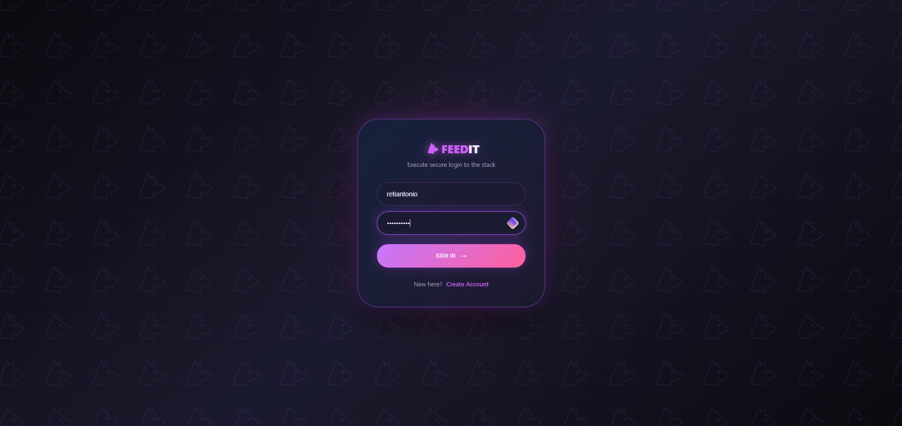
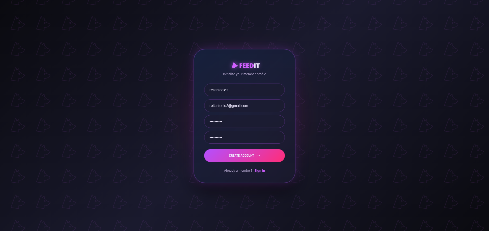
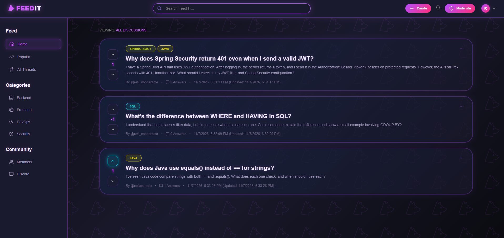
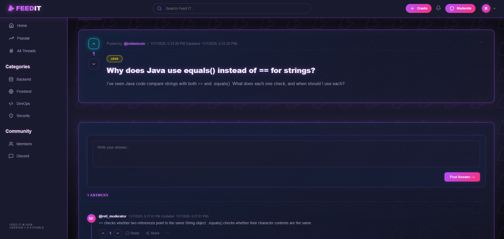
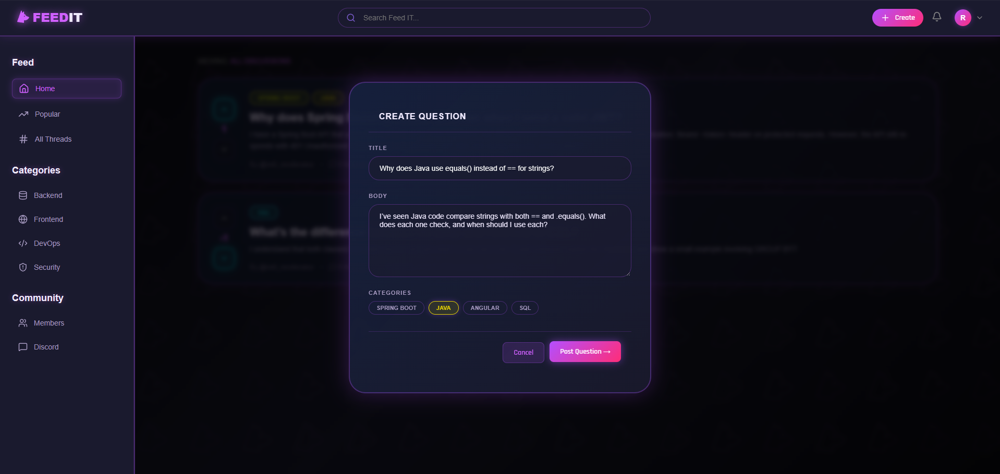
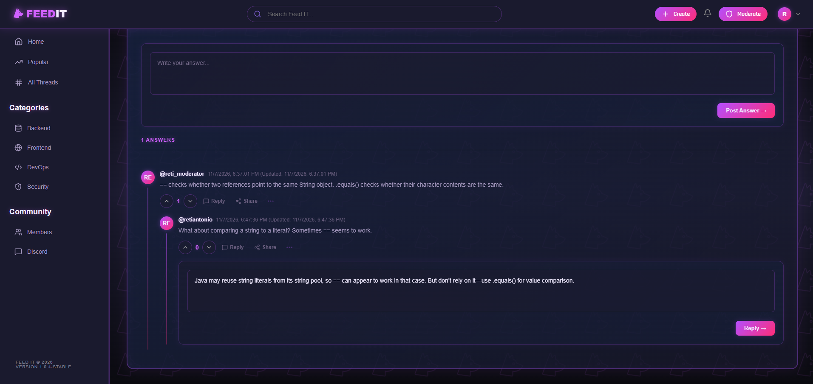
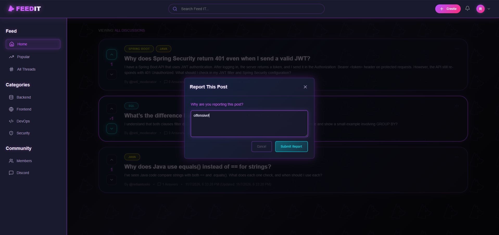
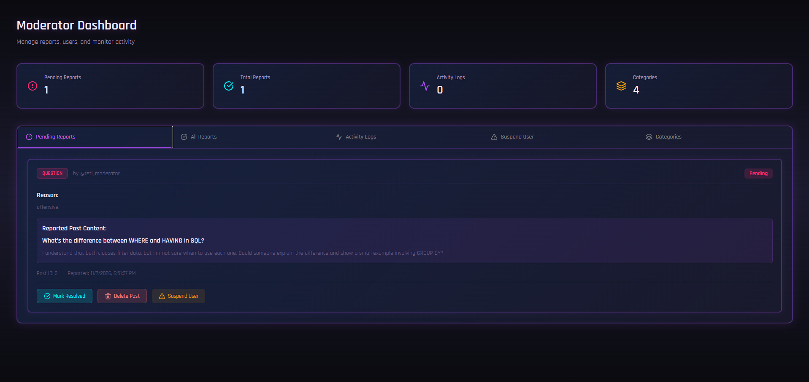

# Mini-StackOverflow

A full-stack forum where users can ask questions, share answers, vote on posts, and help keep the community safe. Moderators can review reports, manage categories, and suspend users.

## Screenshots

<div align="center">
  <table>
    <tr>
      <td align="center">
        
        <br />
        <strong>Login</strong>
      </td>
      <td align="center">
        
        <br />
        <strong>Register</strong>
      </td>
    </tr>
    <tr>
      <td align="center">
        
        <br />
        <strong>Question feed</strong>
      </td>
      <td align="center">
        
        <br />
        <strong>Question and answers</strong>
      </td>
    </tr>
    <tr>
      <td align="center">
        
        <br />
        <strong>Create a question</strong>
      </td>
      <td align="center">
        
        <br />
        <strong>Nested answers</strong>
      </td>
    </tr>
    <tr>
      <td align="center">
        
        <br />
        <strong>Report a post</strong>
      </td>
      <td align="center">
        
        <br />
        <strong>Moderator dashboard</strong>
      </td>
    </tr>
  </table>
</div>

## Features

- Register and log in with JWT authentication
- Ask questions, post answers, and reply in nested threads
- Vote on questions and answers
- Search and browse questions by category
- Report posts and review reports as a moderator
- Manage categories, user suspensions, and moderation activity

## Tech stack

- **Frontend:** React, Vite, React Router, Axios
- **Backend:** Java, Spring Boot, Spring Security, Spring Data JPA
- **Database:** PostgreSQL

## Run locally

### Prerequisites

- Java 25
- Node.js and npm
- PostgreSQL

### 1. Create the database

Create a PostgreSQL database named `feedit_db`. The backend connects to `localhost:5432` using the credentials configured in `src/onlineforum/src/main/resources/application.properties`. Hibernate creates and updates the tables when the backend starts.

### 2. Start the backend

```bash
cd src/onlineforum
./mvnw spring-boot:run
```

On Windows, run `mvnw.cmd spring-boot:run` instead.

### 3. Start the frontend

In another terminal:

```bash
cd src/react-frontend/forum-client-frontend
npm install
npm run dev
```

Open the local URL printed by Vite, usually **http://localhost:5173**.
